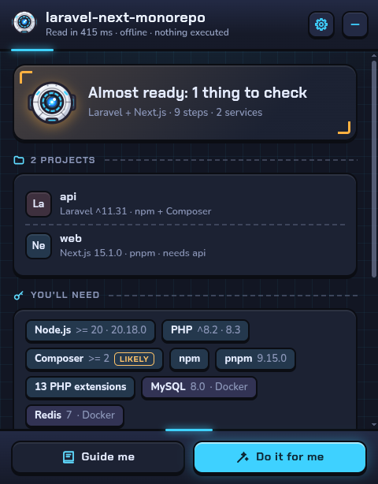
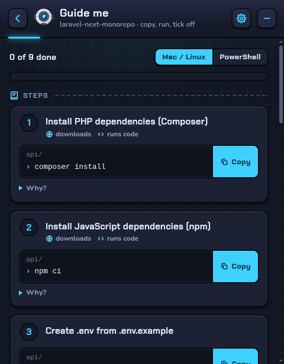
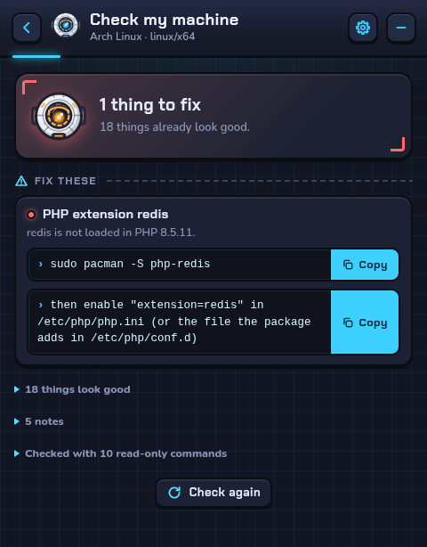
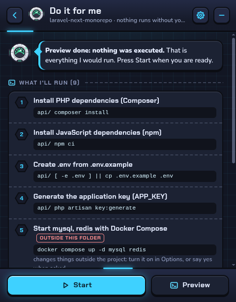

# SeeFast

**See what a project needs, and get it running.** `seefast` reads a project someone else wrote and tells you what this
machine needs and exactly which steps get it running. It works out the answer from the repository's own files:
CI workflows, Dockerfiles and Compose files, dev containers, manifests and lockfiles, version files, env templates,
task runners and READMEs. Then it gives you the choice: follow a guide with a copy button per command, or let it run
the steps with your consent.

It uses no AI, needs no network to analyze, and never executes the project's code while analyzing. Every answer says
which file it comes from and how sure it is; "unknown" is an allowed answer.

<p align="center"></p>

| Overview | Manual setup | This machine | Automated setup |
| --- | --- | --- | --- |
|  |  |  |  |

*The desktop launcher on a Laravel + Next.js monorepo: a floating bubble that turns into these panels.*

> **Name.** SeeFast (`seefast`) was free on npm (including `see-fast`), PyPI, crates.io and Homebrew on 2026-11-01.
> Not yet published. The name lives in `src/brand.ts`.

## Quick start

```bash
npx seefast                 # the setup guide for the current folder
npx seefast doctor          # check this machine against what the project needs
npx seefast setup --dry-run # every command automated setup would run, nothing executed
npx seefast setup           # run them, asking before each one
npx seefast start           # start the dev servers (services → backends → frontends), wait until they answer
```

On the Laravel + Next.js fixture in this repo, the guide begins:

```
Projects
  api                Laravel ^11.31 · PHP + Node.js (npm + Composer)
  web                Next.js 15.1.0 · Node.js (pnpm) · needs api

This machine needs
  • Node.js >= 20 (recommended 20.18.0)  sure
  • PHP ^8.2 (recommended 8.3)  sure
  • Composer >= 2  likely
  • pnpm (recommended 9.15.0)  sure
  • PHP extensions: ctype, dom, fileinfo, filter, libxml, mbstring, openssl, pdo_mysql, redis, session, tokenizer, xml, xmlwriter
  • MySQL 8.0 (database, port 3306; Compose service "mysql" in docker-compose.yml)  sure
  • Redis 7 (cache, port 6379; Compose service "redis" in docker-compose.yml)  sure
  Optional: Docker, Mailpit

Heads-up (2)
  ! api/.env.example sets DB_HOST=mysql, the name of a Compose service. That name only resolves between
    containers; with the app running on your machine use DB_HOST=127.0.0.1 (the published port).
  i README.md says "npm install", but package.json sets packageManager: "pnpm@9.15.0"; using pnpm.

Setup steps (POSIX shell; paths are relative to this folder)
   1. Install PHP dependencies (Composer)  sure  [network, runs third-party code]
      api/ $ composer install
   ...
   5. Generate the application key (APP_KEY)  sure  [runs third-party code]
      api/ $ php artisan key:generate
   6. Start mysql, redis with Docker Compose  likely  [network, runs third-party code, changes things outside the project]
      $ docker compose up -d mysql redis
```

`seefast explain api.key` shows why a step exists and every file that supports or contradicts it.

## Install

* **CLI and library:** Node.js 20 or newer. `npx seefast`, or `npm install -g seefast`. Four pure-JavaScript
  dependencies, no install scripts, no native build step.
* **Desktop launcher:** `app/` (Electron); see [The launcher](#the-launcher). It bundles its own runtime.
* **From source:** `npm ci && npm run build && node dist/cli.js <folder>`.

## Commands

```
seefast [path]                     the setup guide (same as `guide`)
seefast guide [path]               projects, requirements, conflicts, ordered steps, run commands
seefast plan [path] [-o file]      the plan as JSON
seefast explain [path] [id]        why each step / requirement exists, with the files that say so
seefast doctor [path]              check this machine (fixed, read-only commands)
seefast setup [path]               run the steps, asking before each one
seefast start [path] [target...]   start the dev targets with readiness checks
seefast setup-md [path] [--write]  SETUP.md to stdout, or into the project with --write
seefast diff <old-plan.json> [path]   what changed in the setup since a saved plan
seefast support                    languages, frameworks, services and files it can read

--plan <file>   use a saved plan instead of analyzing      --shell <posix|powershell>   commands for that shell
--json          machine-readable (guide, doctor, support)  -v                           evidence references
setup:  --dry-run  --yes  --approve <digest>  --allow-outside  --include-optional  --only <ids>  --from <id>  --resume
start:  --timeout <s>  --until-ready
```

Exit codes: `0` ok · `1` error · `3` doctor found something required missing or the wrong version · `4` a setup step
or a start target failed · `5` declined or stopped · `6` the plan changed since it was approved.

## What it reads, and how it decides

Each question has its own ranking of sources, because the right source depends on the question:

| Question | Strongest evidence first |
| --- | --- |
| Package manager | `packageManager` field → lockfile → CI → dev container → task runner → README → npm by default |
| Runtime versions | constraints (`engines`, `require.php`, framework minimums, locked packages) intersected; then the pin from `.nvmrc`/`.tool-versions`/`mise.toml`, dev container, CI (newest in the matrix), Dockerfile |
| PHP extensions | `composer.json` `ext-*`, every `ext-*` that locked packages require in `composer.lock`, the DB driver in the env template, Dockerfile and CI as weaker signals |
| Services | env template drivers and URLs (`DB_CONNECTION=mysql`, `DATABASE_URL=postgres://…`), Prisma datasource, Compose services the template points at, CI service containers (tests only) |
| Steps | ecosystem providers and framework recipes, corroborated by CI, dev container hooks, task runners and docs |
| Run targets and ports | scripts (`next dev -p 4000`), the docs' own start command, Procfile, `PORT` in the template or code, framework defaults |

Confidence is three levels, **sure / likely / guess**: the winning source's level, raised one level when a different
kind of source agrees, lowered when an equally strong one disagrees. Disagreements become plain-language conflicts:

* `README.md says "npm install", but pnpm-lock.yaml exists; using pnpm.`
* `.nvmrc pins Node.js 18 (lts/hydrogen), but package.json engines.node requires ">=20.9.0"; using Node.js >= 20.9. Installs may fail on Node.js 18; consider updating .nvmrc.`
* `Both package-lock.json and yarn.lock exist; CI (build.yml) runs "yarn install --frozen-lockfile", so using yarn. package-lock.json is probably stale.`
* `Next.js reads .env.local, but Prisma only reads .env; using .env, which every tool here reads.`
* `CI (ci.yml) uses Node.js 20, but package-lock.json: locked dependency x declares engines.node ">=22"…, so it works there; recommending Node.js 20.`

Framework knowledge (Laravel, Next.js, Prisma) is declarative JSON in [`recipes/`](recipes): detection, version
requirements, env conventions, first-run steps (`key:generate`, the SQLite file, migrations, `storage:link`, Passport
keys, Vite/Mix builds, `prisma generate`), run targets. Other ecosystems (Python, Go, Rust, Ruby, Java, .NET, Deno,
Elixir) get generic, lower-confidence support, and repos with only a Makefile fall back to its `setup`/`run` targets.

Details: [docs/DESIGN.md](docs/DESIGN.md) · the plan format field by field: [docs/PLAN-SCHEMA.md](docs/PLAN-SCHEMA.md).

## Guarantees, and how they are checked

| Guarantee | Enforced by | Tested by |
| --- | --- | --- |
| Analysis never runs project code, spawns a process or opens a connection | `src/core` imports no process or network module; all disk access goes through a read-only layer | an import scan of `src/core`, and analyzing every fixture with `child_process`, `net`, `http(s)` and `dns` booby-trapped, with a negative control proving the trap fires |
| No secrets are read or written | real env files, keys and credential files are never opened (only `stat`ed); template values are used only for drivers, hosts, ports and credential-free URLs; quoted commands are redacted | a fixture full of canary secrets: the files are never opened and no canary appears in the plan, guide, explain view or SETUP.md |
| Deterministic | sorted output, no clock or absolute paths in the plan, a content digest | two runs per fixture compared byte for byte; the same repo at another path gives the same digest |
| Portable | BOMs stripped, CRLF normalized before parsing and hashing | every fixture converted to CRLF + BOM on the fly gives the same digest; a committed CRLF + BOM fixture |
| Doctor runs only fixed commands | a fixed list ([docs/DOCTOR.md](docs/DOCTOR.md)), PATH lookup without spawning, no shell, from an empty temporary folder with Corepack/Go/rustup downloads disabled | simulated Ubuntu, Windows and macOS hosts: only listed commands run, nothing runs for missing tools |
| Automated mode is consent-driven | shows every command first; per-step consent, or `--yes` / a digest-bound `--approve`; separate consent for anything outside the project; dry run; stop on first failure; never elevates; never overwrites an env file | fake-spawn tests: nothing runs without consent, declined or dry runs spawn nothing, `sudo` is refused, paths outside the project are refused, resume continues from the failed step |

Automated mode writes its state and logs to `.seefast/` in the project, with a `.gitignore` that hides the folder
from git. Nothing else is written unless you ask (`setup-md --write`). The analysis itself writes nothing.

## The launcher

A small desktop app built around a floating bubble: click it to choose a project folder (or drop a folder on it), and
it turns into a panel with the analysis (led by a README-style quick start: `cd`, install, start, with any steps it
leaves out counted, never hidden), the manual guide (a copy button per command, POSIX or PowerShell), the
doctor, and the consent-driven runner (each command shown before it runs, per-step status, live output, stop and
resume, then "Start the app" with readiness). It reads the same plan as the CLI. "What I can read" (from the home
screen, the overview or Settings) lists the languages, framework recipes and services it knows, built from the same
tables and `recipes/` / `kb/` files as `seefast support`, so a new recipe shows up there without UI changes.

```bash
npm ci && npm run build
cd app && npm ci && node node_modules/electron/install.js && npm start   # npm 11+ skips Electron's download script
```

* Drag it anywhere; it remembers its place per display and stays on screen when monitors change. A drag is never
  taken for a click.
* Panels open toward the side of the screen with room and morph out of the bubble; "reduce motion" is respected.
* Keyboard: Enter opens, arrow keys move the bubble, Escape goes back and collapses; screen-reader labels and live
  status. Global shortcut `Ctrl/Cmd+Alt+K`, a tray or menu-bar icon, recent projects, "changed since last time".
* No network: strict CSP, files served from the app, every other request cancelled, bundled fonts.
* Linux under Wayland opens as a normal window: Wayland does not let apps float or place their windows, and on
  some machines Electron draws nothing into XWayland windows. "Floating bubble" in Settings tries XWayland anyway
  (`SEEFAST_WINDOW=window` gets the normal window back). Per-platform
  details and what was verified: [docs/PLATFORMS.md](docs/PLATFORMS.md).

## Validation

Measured on 32 public repositories (Laravel and Next.js apps, monorepos such as Cal.com, Dub, Formbricks and
Documenso, and Python, Go and Rust projects). Ground truth was written per repository from its own docs and CI, by
reviewers who never saw this tool's output. Full report, method and every failure: [docs/VALIDATION.md](docs/VALIDATION.md).

| | First run, 24 repos | After fixes, same 24 (tuned on) | **8 held-out repos** (never tuned on) |
| --- | --- | --- | --- |
| Required setup steps found | 64% | 70% | **61%** |
| …the README alone covers | 23% | 23% | **21%** |
| Package manager correct | 22/22 | 22/22 | **7/7** |
| Runtime version agrees | 29/30 | 29/30 | **10/12** |
| Services found | 19/34 | 21/34 | **3/6** |

**End-to-end** in a clean container, on 11 repositories that run without a database server: automated setup
followed by "does it answer on its port?" succeeded for **7 of 11**; following the README alone, for **2 of 11**.
Details, and every failure: [docs/VALIDATION.md](docs/VALIDATION.md#end-to-end).

**Speed:** median 52 ms per repository; 323 ms for the largest monorepo (Cal.com: 7,491 files and folders, 113
workspace packages); the slowest cold run was 1.6 s.

## Limitations

* **Coverage is narrow by design.** Node.js (npm, Yarn, pnpm, Bun) with Next.js and Prisma recipes, and PHP with
  Composer and a Laravel recipe, are supported in depth. Python, Go, Rust, Ruby, Java, .NET, Deno and Elixir get
  generic detection: a runtime version, a likely install command, sometimes a run command, all at low confidence.
  Django, Rails, Symfony, Nuxt, Remix, SvelteKit and others have no recipes yet.
* **About a third of required steps are missed** on unseen repos (validation above). The usual reasons:
  setup that lives on an external docs website; one-command setup scripts the plan lists as their individual steps;
  accounts and keys only a person can get (Stripe CLI, Supabase, Tinybird); repos whose only documented path is
  Docker while the plan proposes the native path (the Docker path is offered as an alternative run target).
* **It does not understand code.** Env variables found in code come from regular expressions (`process.env.X`,
  `env('X')`); dynamic names are missed. Scripts and READMEs are classified against a command grammar, not
  interpreted; README prose is not read.
* **Lockfile `engines` are soft.** Only direct, non-optional dependencies count, and a version CI tests wins over them.
* **Services are not installed.** The plan starts them with the repo's Compose file when it has one, otherwise it
  asks you to run them and the doctor gives install advice. Generating a Compose file is not implemented.
* **Runtimes are not installed.** The doctor gives OS-specific advice, preferring a version manager you already have.
* **Interactive setup commands** (wizards such as `php artisan koel:init`) get no input in automated mode; the plan
  marks commands it learned from docs as low confidence and says to run them by hand if they wait.
* **Windows and macOS** are covered by unit tests with simulated hosts and the CI matrix; the doctor and the launcher
  have been run for real only on Linux so far ([docs/PLATFORMS.md](docs/PLATFORMS.md)).
* **The knowledge base ages.** Install advice and framework minimums are dated (`reviewed`); the doctor prints the
  date. Package names that vary by distribution release are flagged in the data.

## Programmatic API

```js
import { analyze, runDoctor, runSetup, renderGuide } from 'seefast';

const plan = analyze('/path/to/repo');            // the plan; pure, synchronous, read-only
console.log(plan.summary, plan.conflicts.map((c) => c.message));
const report = await runDoctor(plan, { root: '/path/to/repo' });
```

Also exported: `checkPlan`, `planDigest`, `renderExplain`, `renderSetupMd`, `renderAction`, `diffPlans`, `startTargets`,
`selectSteps`, and every plan type (`seefast/schema` has the types without Node imports, for UIs).

## Development

```bash
npm ci && npm run build
npm test                         # 174 tests: fixtures, real-world traps, guarantees, consent, doctor, geometry, parsers
UPDATE_EXPECTED=1 npm test       # regenerate test/expected/*.json after reviewing the change
node scripts/make-crlf-fixture.mjs
cd app && npm run smoke          # drive the real launcher window (unset ELECTRON_RUN_AS_NODE in VS Code terminals)
node validation/run-corpus.mjs && node validation/score.mjs --set=dev   # needs validation/repos (see VALIDATION.md)
```

Fixtures (`fixtures/`) cover the known traps: a README that says npm next to a pnpm lockfile, a Laravel + Next.js
monorepo with Compose and CI, no `.env.example`, `.nvmrc` against `engines`, a CI matrix, two lockfiles, Laravel on
SQLite, a pnpm + turbo workspace, Prisma + Postgres, Django, a Makefile-only repo with submodules and LFS, no manifest
at all, a CRLF + BOM copy, and canary secrets. Each has a golden plan and assertions for its trap.

## Documentation

[DESIGN.md](docs/DESIGN.md) (architecture, survey, evidence model, open questions) ·
[DECISIONS.md](docs/DECISIONS.md) · [PLAN-SCHEMA.md](docs/PLAN-SCHEMA.md) · [DOCTOR.md](docs/DOCTOR.md) ·
[PLATFORMS.md](docs/PLATFORMS.md) · [VALIDATION.md](docs/VALIDATION.md) · [CHANGELOG.md](CHANGELOG.md)

## License

MIT
